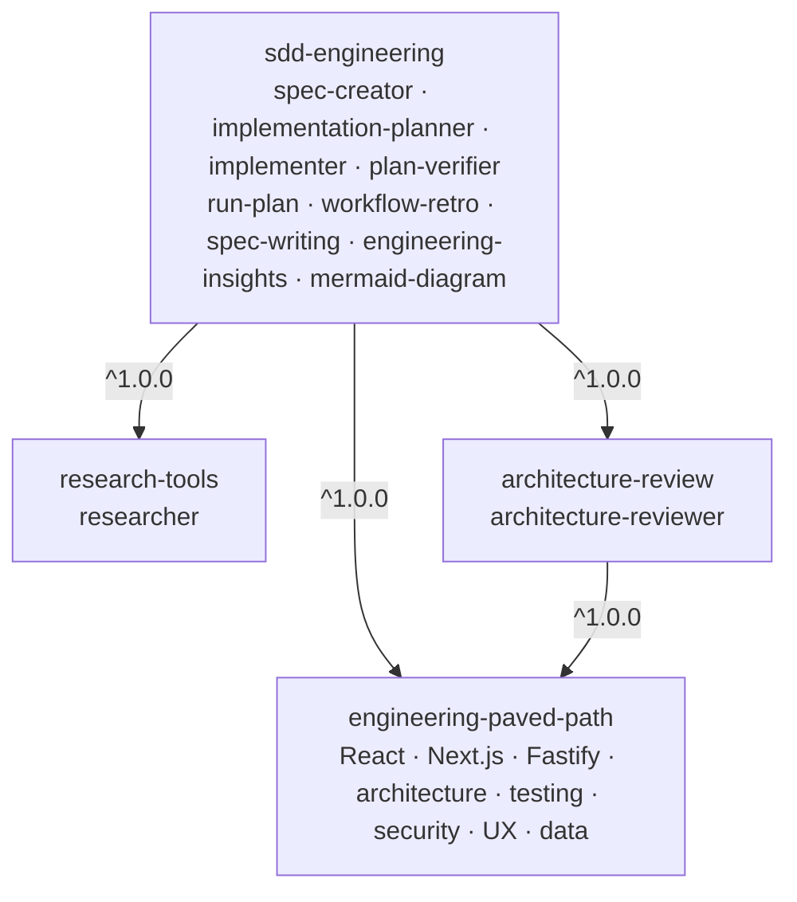
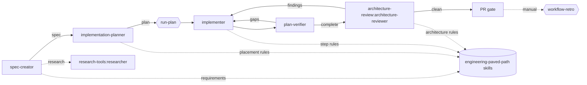

# Spec: SDD Engineering and its dependency plugins

Status: draft · Source: `~/WebstormProjects/dev-digest/.claude/` (agents, skills, hooks) · Release plan: team slides
"Steps 2–7" (component selection, dependency graph, packaging, registration, validation, 1.0.0 release).

Items marked **(decide)** need a team decision; the default is what gets built if nobody objects.

## 1. Goal

Turn the Spec-Driven Development pipeline that lives inside one project (`dev-digest`) into four
installable, project-independent plugins. Shared knowledge is packaged once and reused through
plugin dependencies. Nothing in the published plugins refers to `dev-digest`, its folders, its
packages, its MCP server or its repository.

## 2. Plugins

| Plugin | Role | Components | Depends on |
|---|---|---|---|
| `engineering-paved-path` | Reusable knowledge | Skills: `react-best-practices`, `next-best-practices`, `fastify-best-practices`, `onion-architecture`, `frontend-ui-architecture`, `react-testing-library`, `security`, `ux-review`, `zod`, `typescript-expert`, `drizzle-orm-patterns`, `postgresql-table-design` | — |
| `research-tools` | Reusable agent | Agent: `researcher` (read-only) | — |
| `architecture-review` | Reusable agent | Agent: `architecture-reviewer` (read-only, generalized) | `engineering-paved-path` `^1.0.0` |
| `sdd-engineering` | Workflow | Agents: `spec-creator`, `implementation-planner`, `implementer`, `plan-verifier`<br>Skills: `run-plan`, `workflow-retro`, `spec-writing`, `engineering-insights`, `mermaid-diagram`<br>Hooks: path and Bash guards for its agents<br>Evals | `engineering-paved-path`, `research-tools`, `architecture-review`, all `^1.0.0` |

Where a skill goes:

- Engineering standards that several agents and future plugins apply (stack practices, architecture,
  testing, security, UX) → `engineering-paved-path`.
- Skills only the SDD agents use (`spec-writing`, `engineering-insights`, `mermaid-diagram`, `run-plan`,
  `workflow-retro`) → `sdd-engineering`. If a second plugin ever needs one, it moves to a shared plugin
  in a minor release; it is never copied.
- `ux-review`, `zod`, `typescript-expert`, `drizzle-orm-patterns`, `postgresql-table-design` are not on
  the slide's list but the SDD agents route to them, so they ship in `engineering-paved-path`. **(decide)**

Not carried over (slide "Не переносимо", plus what the source shows):

- Product specs and plans (`.claude/plans/**`, `specs/**`), secrets, `settings.local.json`, caches
  (`.devdigest/cache/**`), `scheduled_tasks.lock`.
- DevDigest-specific instructions: `references/this-repo.md` in `onion-architecture` and
  `frontend-ui-architecture`, the `reviewer-core` invariants, "Known limits", vendored `shared` rules,
  the `pnpm` workaround, `drizzle-kit` and Docker test lanes, the `devdigest` MCP tools.
- `scripts/check-changed.sh` (hard-codes the project's packages and package manager).
- Agents not in this release: `security-reviewer`, `test-writer`, `doc-writer`, `brainstorm`; skill
  `pr-self-review`. **(decide: later plugins or never)**

## 3. Dependency graph



Who uses what at run time:



## 4. Making the components generic

| Source assumption | In the plugin |
|---|---|
| Paths such as `.claude/plans/`, `server/specs/`, `docs/retro/ledger/` | Explicit inputs. Each agent and skill takes the path as an argument; the default comes from a plugin option (`userConfig`): `specs_dir` = `specs`, `plans_dir` = `.claude/plans`, `retro_dir` = `docs/retro`. Referenced as `${user_config.<key>}` in skills and as `CLAUDE_PLUGIN_OPTION_<KEY>` in hook scripts |
| Package list `server`, `client`, `reviewer-core`, `e2e`, `mcp` | "the project's packages or modules", discovered from the repository and its `AGENTS.md` / `CLAUDE.md` |
| `.claude/scripts/check-changed.sh` | "the project's verification commands" (typecheck, related tests, lint). The planner records them in plan §5; the implementer and plan-verifier run exactly those |
| `node .claude/skills/<skill>/scripts/...` | `${CLAUDE_SKILL_DIR}/scripts/...` inside the skill (slide 4) |
| Reading another skill as `.claude/skills/<name>/SKILL.md` | Loading it through the plugin namespace with the Skill tool: `engineering-paved-path:react-best-practices` (slide 4). Agents that load skills get `Skill` in their `tools` |
| `security-reviewer` in the review loop, review bundle from `pr-self-review` | `run-plan` reviews with `architecture-review:architecture-reviewer` only; the orchestrator passes the changed-file list and `git diff` instead of a bundle. A security reviewer joins the loop when that plugin exists **(decide)** |
| `test-writer`, `doc-writer`, `/pr-self-review` stages in `run-plan` | Removed from the stages. `--with-tests` makes the main session write the plan's test items |
| `devdigest` MCP tools in `spec-creator` | Removed. Live-system facts come from researcher reports |
| Hooks wired in agent frontmatter with `${CLAUDE_PROJECT_DIR}/.claude/hooks/*.sh` | Plugin hooks in `hooks/hooks.json`, scripts in `scripts/`, called as `"${CLAUDE_PLUGIN_ROOT}"/scripts/<guard>.sh` (see §6, risk 1) |
| `INSIGHTS.md` per package | Kept as a convention of `engineering-insights`; when a project has no `INSIGHTS.md`, the skill says so and continues |

A CI step fails the build when a plugin file contains a blocked term: `dev-digest`, `devdigest`,
`DevDigest`, `.devdigest`, `reviewer-core`, `server/clones`, `/Users/`, `burnjohn`.

## 5. Plugin layout and docs

```
plugins/<name>/
├── .claude-plugin/plugin.json    # name, version, description, author, license, keywords, dependencies, userConfig
├── README.md                     # what it gives you, install, usage examples, options, how it fits the others
├── CHANGELOG.md                  # versions and releases; "## [Unreleased]" on top (release script input)
├── agents/ | skills/ | hooks/hooks.json | scripts/
└── evals/                        # sdd-engineering only (claude plugin eval)
```

- `sdd-engineering/README.md` is the guide to the whole workflow, adapted from the source
  `agents/README.md`: the pipeline diagram, when to run each agent by hand, what `run-plan` automates,
  inputs and outputs per agent, the guard hooks, token-efficient hand-offs, and how the dependency plugins
  plug in. The other READMEs are adapted from the source skill READMEs where they exist.
- Every vendored third-party skill keeps its upstream license and attribution in a
  `THIRD_PARTY_NOTICES.md` inside `engineering-paved-path` (source: the project's `skills-lock.json`).
- Version lives only in `plugin.json` (the slide lists it next to name, owner and source; the
  marketplace entry carries name, source, description, category and tags).

## 6. Risks to settle first (implementation step 1)

1. **Agent-scoped guards.** Plugin agents may not support `hooks` in their frontmatter. Probe: a plugin
   with an agent that declares a hook, loaded with `--plugin-dir`. If unsupported, the guards move to
   `hooks/hooks.json` and each script acts only when the hook input names the guarded agent
   (`agent_type`). If the input does not carry it, the write guards cannot be scoped; then the agents'
   `tools` lists stay the hard limit and the guards are documented as advisory **(decide on fallback)**.
2. **Namespaced skills from a dependency.** Confirm that a `sdd-engineering` agent can load
   `engineering-paved-path:<skill>` through the Skill tool when both plugins are installed.
3. **`${user_config.*}` in agent files.** If it is substituted only in skills, agents read the paths
   from the skill they load or from the explicit input.
4. **Dependency resolution.** `^1.0.0` ranges resolve against tags `<plugin>--v<version>`, which the
   release script already creates. Until the first tags exist, validate locally with `--plugin-dir`.

## 7. Implementation steps

1. Probe the four risks above with a throw-away plugin; record the results in this spec.
2. `engineering-paved-path`: copy the skills, remove `this-repo.md` and project examples, generalize
   wording, add `THIRD_PARTY_NOTICES.md`, README, CHANGELOG.
3. `research-tools` and `architecture-review`: generalize the agents; the reviewer loads
   `engineering-paved-path:onion-architecture` and `:frontend-ui-architecture` for its rules.
4. `sdd-engineering`: four agents, five skills, guard scripts, `userConfig`, README with the workflow,
   CHANGELOG, evals (namespaces resolve; spec → plan → implement → review → verify on a fixture repo).
5. Register the four plugins in `.claude-plugin/marketplace.json` (category, tags, description).
6. Validate (slide 6): `claude plugin validate --strict` for the marketplace and each plugin (Marketplace
   checks workflow), blocked-terms check, load all four with `--plugin-dir`, run the evals.
7. Release 1.0.0 (slide 7): `npm run release -- <plugin> 1.0.0` for `engineering-paved-path`,
   `research-tools`, `architecture-review`, then `sdd-engineering`. Tags: `<plugin>--v1.0.0`.
   Release evidence (version, tag, commit SHA, eval results) goes into the version's section in the
   plugin's `CHANGELOG.md`, so the catalog site shows it.

## 8. Done when

- Four plugins with README, CHANGELOG, `plugin.json` and the components above; marketplace lists them.
- Marketplace checks pass: strict validation and no blocked terms.
- Evals pass: every agent and skill is reachable through its plugin namespace, and the SDD chain runs on a
  fixture repository.
- The catalog site shows the four plugins, their components and dependency links.
