# sdd-engineering

Spec Driven Development (SDD) for Claude Code: a spec with testable acceptance criteria, a plan that
traces every step to those criteria, phased implementation, verification against the plan and an
architecture review loop, with guard hooks that keep each agent in its lane.

```
/plugin marketplace add Sotvorenniy/ai-market
/plugin install sdd-engineering@ai-market
```

Installing it also installs its dependencies from the same marketplace:
[`engineering-paved-path`](../engineering-paved-path), [`research-tools`](../research-tools) and
[`architecture-review`](../architecture-review).

**Requirements:** `git`, and `jq` for the guard hooks (without `jq` the guards deny the guarded calls).
`node` 18+ for `workflow-retro`.

## What is inside

| Component | Type | Role |
|---|---|---|
| `spec-creator` | agent (opus) | What and why. Asks questions in six categories, then writes one EARS spec; unknowns stay as `[NEEDS CLARIFICATION]` |
| `implementation-planner` | agent (opus) | How and in what order. Checks the spec is ready, asks implementation questions and the execution mode, writes a plan whose every step cites AC-IDs |
| `implementer` | agent (sonnet) | Executes one plan phase, keeps existing tests green, runs the plan's verification commands |
| `plan-verifier` | agent (sonnet) | Checks the code against every plan item and every AC with `path:line` or command evidence; scopes `code` and `final` |
| `run-plan` | skill | `/sdd-engineering:run-plan <plan>`: drives an approved plan to a PR-ready state with checkpoints and resumable state |
| `workflow-retro` | skill (manual only) | `/sdd-engineering:workflow-retro`: cost and quality retrospective of a finished run, with proposals |
| `spec-check` | skill | `/sdd-engineering:spec-check <spec>`: read-only check that a spec is ready for planning, with each blocking finding and its line |
| `spec-writing` | skill | The spec rules: template, EARS patterns, IDs, NFRs, revisions, self-check |
| `engineering-insights` | skill | Recall and record non-obvious findings in per-package `INSIGHTS.md` files |
| `mermaid-diagram` | skill | Mermaid syntax for workflow and sequence diagrams in specs |
| guard hooks | hooks | Limit where each agent may write and which commands it may run |
| version log | hook | Records the active plugin version and marketplace for every session (see [Version log](#version-log)) |

## The workflow

```mermaid
flowchart LR
  SC[spec-creator<br/>what and why] -->|approved spec, AC-IDs| P[implementation-planner<br/>how and order]
  R[research-tools:researcher<br/>optional] -.-> SC
  P -->|writes| PL[(.claude/plans/slug.md)]
  PL --> RP{{/run-plan}}
  RP --> I[implementer<br/>one run per phase]
  I --> VC[plan-verifier<br/>scope code]
  VC -->|not met| I
  VC -->|complete| A[architecture-review:<br/>architecture-reviewer]
  A -->|CRITICAL or HIGH| I
  A -->|clean| T[tests by the main session<br/>--with-tests]
  T --> VF[plan-verifier<br/>scope final]
  VF -->|complete| G[PR gate: you commit and push]
  G -. optional .-> WR{{/workflow-retro}}
```



1. **Spec.** Run `spec-creator` with the feature and your design sources (text, screenshots, Figma
   export, code paths). It returns a Questions Report first; answer it, and it writes
   `specs/YYYY-MM-DD-<feature>.md` (or `<module>/specs/` for a one-module change). Move the spec to
   `Status: approved` when no `[NEEDS CLARIFICATION]` marker is left.
   ```
   claude --agent sdd-engineering:spec-creator
   ```
   Before planning, run `/sdd-engineering:spec-check <spec>`: it answers `READY for planning` or
   lists what blocks it, each with its line.
   As the main session it can launch `research-tools:researcher` agents in parallel; as a subagent it
   returns "Research requests" for you to run.
2. **Plan.** Ask for `implementation-planner` with the spec path. It returns an Intake Report (spec
   readiness, implementation questions, multi-agent or single-agent). Answer it; it writes
   `.claude/plans/<slug>.md` and replies with a short summary.
3. **Run.** `/sdd-engineering:run-plan <slug>` executes the plan: one `implementer` run per phase,
   `plan-verifier` (scope `code`), the architecture review loop (at most 3 rounds; CRITICAL and HIGH
   are fixed, you decide on each MEDIUM, LOW is logged), a re-check of what the fixes touched, tests
   with `--with-tests`, and a final gate where you approve the commit and push. Run state lives in
   `.claude/plans/<slug>/`, so `--resume` continues an interrupted run.
4. **Retro (optional).** `/sdd-engineering:workflow-retro` reports tokens, agents, launch order and
   per-agent difficulties, and proposes changes to agents, skills and briefs. It runs only when you ask.

Spec and plan are written by hand on purpose: they are where your decisions go. `run-plan` never
starts `spec-creator` or `implementation-planner` itself.

## Inputs and conventions

| What | Default | Change it |
|---|---|---|
| Specs folder | root `specs/`, or `<module>/specs/` for a one-module change, unless the project's `AGENTS.md` / `CLAUDE.md` says otherwise | Tell `spec-creator` the folder |
| Plans folder | `.claude/plans/` (add it to `.gitignore`) | Tell the agents the folder **and** set `SDD_PLANS_DIR` in your settings `env`, so the guard hooks agree |
| Retro ledger | `docs/retro/ledger/` | Pass the folder to `workflow-retro` |
| Caches | `.claude/cache/<skill>/` (add it to `.gitignore`) | — |
| Verification commands | Whatever the project uses; the planner writes them into plan §5 | Document them in `AGENTS.md` so the planner finds them |

The agents read the project's own guidance first: root `AGENTS.md` or `CLAUDE.md`, then the touched
packages' `AGENTS.md` and `INSIGHTS.md`. Project rules win over generic skill advice. Stack knowledge
comes from `engineering-paved-path` skills, loaded by namespace (for example
`engineering-paved-path:onion-architecture`).

## Guard hooks

Plugin agents cannot carry hooks in their own frontmatter, so the guards are plugin hooks that act
only when the hook input names the agent (`agent_type`). They do not affect the main session or
other agents.

| Agent | Guard | Allows / denies |
|---|---|---|
| `spec-creator` | Edit/Write | allows only `*.md` directly inside a `specs/` folder; denies spec-folder `README.md` and everything else |
| `implementation-planner` | Edit/Write | allows only `<plans folder>/<slug>.md` |
| `implementer` | Edit/Write | denies new test files, lockfiles, specs, the plans folder, dependency folders and edits to existing migrations |
| `implementer` | Bash | denies `git commit`/`push`, `rm -r`, `docker compose down -v` and shell writes into source files (`>`, heredocs, `sed -i`, `tee`, python/node writes); asks before dependency changes |
| `plan-verifier` | Bash | allows only single read-only commands: test runners, type checkers, linters without `--fix`, read-only `git`, `ls`/`cat`/`wc`/`jq`/`head`/`tail` |

Project-specific do-not-touch paths are not in the hooks: the planner lists them in plan §2 and the
implementer follows them.

## Version log

A `SessionStart` hook appends one line per session to `.claude/cache/sdd-engineering/sessions.jsonl`
in the project. It shows which version actually ran, for example after `plugin update` or after
switching to the stable channel:

```json
{"ts":"2026-10-18T17:30:02Z","event":"session_start","plugin":"sdd-engineering","version":"1.2.0","marketplace":"ai-market","source":"startup","session_id":"…","plugin_root":"/Users/me/.claude/plugins/cache/ai-market/sdd-engineering/1.2.0"}
```

`marketplace` is `ai-market` (latest), `ai-market-stable` (stable) or `local` (`--plugin-dir`). The hook
prints nothing, so it adds no model context, and it never blocks a session. Nothing leaves the machine.
Set `SDD_VERSION_LOG=off` in your settings `env` to turn it off.

## Token-efficient hand-offs

- Pass paths, not text: plans, reports and diffs are files; agents read the sections they need.
- One implementer run per phase keeps each context small.
- The planner's **Context** lines stop the implementer re-reading `AGENTS.md`, `INSIGHTS.md` and the skills.
- `plan-verifier` scope `final` re-checks only test items, AC test evidence and items whose files changed.
- `opus` only where a wrong call is expensive (spec, plan); `sonnet` for the rest. Raise a single run
  with `model: "opus"` on the Agent call instead of changing the default.
- Small review fixes are cheaper in the main session than in a new implementer run.

## Evals

`evals/` checks that the agents and skills resolve through the `sdd-engineering:` namespace, that
`spec-writing` answers from its own rules, and that `spec-creator` stops at its intake gate on a vague
request. The plugin loads only when its dependencies are present, and the eval sandbox loads only the
target plugin, so run the suite against the installed plugin:

```
claude plugin eval sdd-engineering@ai-market
```

Before the dependencies are released, run it on a local copy without the `dependencies` field.

## Not in this release

`security-reviewer`, `test-writer`, `doc-writer` and a pre-PR self-review will ship as separate
plugins. Until then the review loop uses `architecture-review` only, and tests are written by the main
session with `--with-tests`.

## Versions

See [CHANGELOG.md](CHANGELOG.md). Releases are tagged `sdd-engineering--v<version>`.
